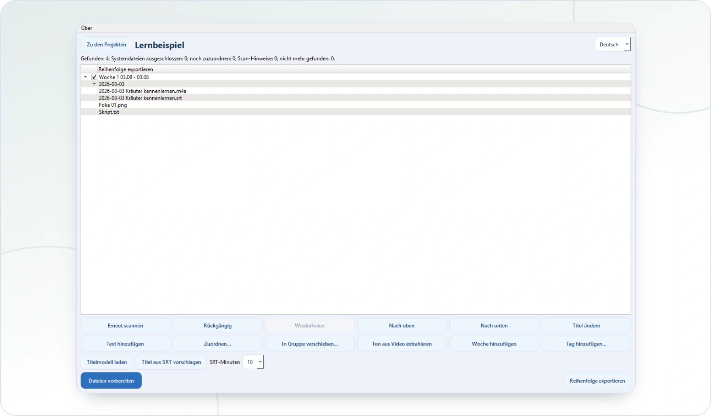

<!-- ppk-readme:head:start -->
<a href="https://popovantondev.github.io/StudyArchivePrep/index.html"><picture><source media="(prefers-color-scheme: dark)" srcset="https://raw.githubusercontent.com/popovantondev/StudyArchivePrep/main/docs/readme/header-de-dark.9ec6c581.svg"></picture></a>
<!-- ppk-readme:head:end -->

# Study Archive Prep

[Русский](README.ru.md) · **Deutsch** · [English](README.en.md)

<!-- ppk-readme:body:start -->
<p>
<a href="https://github.com/popovantondev/StudyArchivePrep"><picture><source media="(prefers-color-scheme: dark)" srcset="https://raw.githubusercontent.com/popovantondev/StudyArchivePrep/main/docs/readme/btn-source-de-dark.f619e7cf.svg"></picture></a>
<a href="https://popovantondev.github.io/StudyArchivePrep/index.html"><picture><source media="(prefers-color-scheme: dark)" srcset="https://raw.githubusercontent.com/popovantondev/StudyArchivePrep/main/docs/readme/btn-website-de-dark.d2be2680.svg"></picture></a>
<a href="https://popovantondev.github.io/StudyArchivePrep/Guide-de.html"><picture><source media="(prefers-color-scheme: dark)" srcset="https://raw.githubusercontent.com/popovantondev/StudyArchivePrep/main/docs/readme/btn-guide-de-dark.e75537d5.svg"></picture></a>
<a href="https://github.com/popovantondev/StudyArchivePrep/issues/new/choose"><picture><source media="(prefers-color-scheme: dark)" srcset="https://raw.githubusercontent.com/popovantondev/StudyArchivePrep/main/docs/readme/btn-bug-de-dark.180e5053.svg"></picture></a>
</p>

<p><a href="https://raw.githubusercontent.com/popovantondev/StudyArchivePrep/main/docs/images/study-archive-prep-workspace-de.png"><picture><source media="(prefers-color-scheme: dark)" srcset="https://raw.githubusercontent.com/popovantondev/StudyArchivePrep/main/docs/readme/preview-de-dark.5eca1ac8.webp"></picture></a><br>
<sub><a href="https://raw.githubusercontent.com/popovantondev/StudyArchivePrep/main/docs/images/study-archive-prep-workspace-de.png">Ganzer Screenshot</a></sub></p>

<picture><source media="(prefers-color-scheme: dark)" srcset="https://raw.githubusercontent.com/popovantondev/StudyArchivePrep/main/docs/readme/divider-dark.4fe89eda.svg"></picture>
<!-- ppk-readme:body:end -->

<!-- public-release:start -->
Ordnet Lernmaterial nach Datum, extrahiert Audio und bereitet die Reihenfolge für Telegram Media Sender vor.

**macOS 13+ · Apple Silicon · Nur Quellcode 0.1.0**

**[Quellcode](https://github.com/popovantondev/StudyArchivePrep)** · **[Anleitung](https://popovantondev.github.io/StudyArchivePrep/Guide-de.html)** · **[Fehler melden](https://github.com/popovantondev/StudyArchivePrep/issues/new/choose)**

**Voraussetzungen und Grenzen:** Frühe Entwicklung: nur Quellcode, kein fertiges Installationspaket. Python 3.12; lokales Modell und Engine für Titelvorschläge separat einrichten.

**Erste Schritte:** Die Anleitung zum Start aus dem Quellcode lesen. Die App sendet selbst keine Materialien an Telegram.
<!-- public-release:end -->

Study Archive Prep ordnet Lernmaterial nach Datum, hilft bei der Prüfung von Aufnahmen und Untertiteln und erstellt einen Veröffentlichungsplan für Telegram Media Sender.

## Projektstatus

Dies ist eine frühe Entwicklungsversion. Die App scannt ausgewählte Quellordner, ordnet Dateien nach Datum und Woche, lässt die Veröffentlichungsreihenfolge prüfen und bearbeiten, kopiert Dateien und erstellt ZIP-Archive mit Wiederherstellungsjournal, extrahiert Ton ohne Neukodierung und exportiert einen versionierten Veröffentlichungsplan. Für russische lokale Titelvorschläge werden die ersten fünf oder zehn Minuten einer ausgewählten SRT-Datei analysiert; Modell und lokale Laufzeit müssen installiert sein. Die App sendet keine Telegram-Nachrichten.

## Aus den Quellen starten

Benötigt Python 3.12 unter macOS.

```bash
python3.12 -m venv .venv
source .venv/bin/activate
python -m pip install -r requirements.txt
python -m pip install -e .
study-archive-prep
```

Für eine getrennte UI-Vorschau `--data-dir /tmp/study-archive-prep-preview` angeben. Damit werden lokale Einstellungen und App-Daten umgeleitet.

## Datensicherheit und Datenschutz

Quellordner werden beim Erstellen eines Projekts oder nach einem erneuten Scan lokal untersucht. Die Ausgabe wird getrennt gespeichert; temporäre Dateien und ein privates Wiederherstellungsjournal schützen bestehende Dateien vor Überschreiben. Extrahierter Ton wird zunächst in privaten App-Daten gespeichert und danach in die vorbereitete Ausgabe kopiert. Originalaufnahmen bleiben erhalten. Dateien werden nicht ins Internet hochgeladen. Lernmaterial, Untertiteltexte, private Pfade, lokale Projekte, Modellgewichte, Kontodaten und Laufzeitprotokolle gehören nicht in Git.

Die Anwendung verwendet SQLite für Projektstatus und Operationsverlauf. Modellgewichte werden nur nach einem ausdrücklichen Klick heruntergeladen und nicht im Repository gespeichert. Siehe [Rechte und Hinweise zu Drittsoftware](THIRD_PARTY_NOTICES.md).

## Entwicklung

Siehe die [Entwicklungsanleitung](docs/de/development.md), den [Architekturüberblick](docs/de/architecture.md) und die [Release-Prüfliste](docs/release-check.md).

## Rechte und Erlaubnisse

Der eigene Quellcode unterliegt den Bedingungen in `RIGHTS.md`. Öffentliche Sichtbarkeit gewährt keine Erlaubnis zur Wiederverwendung. Für Drittsoftware und das Modell gelten deren eigene Lizenzen.
