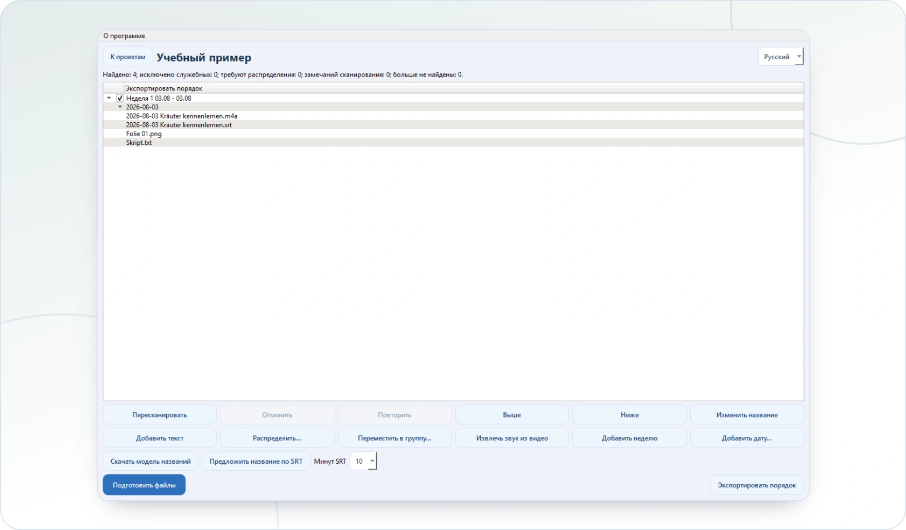

<!-- ppk-readme:head:start -->
<a href="https://popovantondev.github.io/StudyArchivePrep/index-ru.html"><picture><source media="(prefers-color-scheme: dark)" srcset="https://raw.githubusercontent.com/popovantondev/StudyArchivePrep/main/docs/readme/header-ru-dark.64f54970.svg"></picture></a>
<!-- ppk-readme:head:end -->

# Study Archive Prep

**Русский** · [Deutsch](README.md) · [English](README.en.md)

<!-- ppk-readme:body:start -->
<p>
<a href="https://github.com/popovantondev/StudyArchivePrep"><picture><source media="(prefers-color-scheme: dark)" srcset="https://raw.githubusercontent.com/popovantondev/StudyArchivePrep/main/docs/readme/btn-source-ru-dark.0b8494cd.svg"></picture></a>
<a href="https://popovantondev.github.io/StudyArchivePrep/index-ru.html"><picture><source media="(prefers-color-scheme: dark)" srcset="https://raw.githubusercontent.com/popovantondev/StudyArchivePrep/main/docs/readme/btn-website-ru-dark.01c04693.svg"></picture></a>
<a href="https://popovantondev.github.io/StudyArchivePrep/Guide-ru.html"><picture><source media="(prefers-color-scheme: dark)" srcset="https://raw.githubusercontent.com/popovantondev/StudyArchivePrep/main/docs/readme/btn-guide-ru-dark.0e8dded2.svg"></picture></a>
<a href="https://github.com/popovantondev/StudyArchivePrep/issues/new/choose"><picture><source media="(prefers-color-scheme: dark)" srcset="https://raw.githubusercontent.com/popovantondev/StudyArchivePrep/main/docs/readme/btn-bug-ru-dark.503333a7.svg"></picture></a>
</p>

<p><a href="https://raw.githubusercontent.com/popovantondev/StudyArchivePrep/main/docs/images/study-archive-prep-workspace-ru.png"><picture><source media="(prefers-color-scheme: dark)" srcset="https://raw.githubusercontent.com/popovantondev/StudyArchivePrep/main/docs/readme/preview-ru-dark.e5f91e77.webp"></picture></a><br>
<sub><a href="https://raw.githubusercontent.com/popovantondev/StudyArchivePrep/main/docs/images/study-archive-prep-workspace-ru.png">Снимок целиком</a></sub></p>

<picture><source media="(prefers-color-scheme: dark)" srcset="https://raw.githubusercontent.com/popovantondev/StudyArchivePrep/main/docs/readme/divider-dark.4fe89eda.svg"></picture>
<!-- ppk-readme:body:end -->

<!-- public-release:start -->
Организует учебные материалы по датам, извлекает аудио и готовит порядок публикации для Telegram Media Sender.

**macOS 13+ · Apple Silicon · Только исходники 0.1.0**

**[Исходники](https://github.com/popovantondev/StudyArchivePrep)** · **[Инструкция](https://popovantondev.github.io/StudyArchivePrep/Guide-ru.html)** · **[Сообщить об ошибке](https://github.com/popovantondev/StudyArchivePrep/issues/new/choose)**

**Требования и ограничения:** Ранняя разработка: доступны исходники, готового установочного пакета нет. Python 3.12; локальная модель и движок для подсказок заголовков устанавливаются отдельно.

**Первые шаги:** Откройте руководство запуска из исходников. Программа сама не отправляет материалы в Telegram.
<!-- public-release:end -->

Study Archive Prep раскладывает учебные материалы по датам, помогает проверить записи и субтитры и готовит порядок публикации для Telegram Media Sender.

## Состояние проекта

Это ранняя версия в разработке. Программа сканирует выбранные папки, распределяет файлы по датам и неделям, позволяет проверить и изменить порядок публикации, копирует файлы и создаёт ZIP с журналом восстановления, извлекает звук из видео без перекодирования и экспортирует версионируемый план. Для локального предложения русского названия анализируются первые пять или десять минут выбранного SRT; нужны скачанная модель и локальный движок. Программа не отправляет сообщения в Telegram.

## Запуск из исходников

Для сборки нужен Python 3.12 на macOS.

```bash
python3.12 -m venv .venv
source .venv/bin/activate
python -m pip install -r requirements.txt
python -m pip install -e .
study-archive-prep
```

Для отдельного просмотра интерфейса передайте `--data-dir /tmp/study-archive-prep-preview`. Этот параметр перенаправляет локальные настройки и данные приложения.

## Сохранность и приватность

Исходные папки сканируются локально при создании проекта или по команде повторного сканирования. Результат сохраняется отдельно; программа использует временные файлы и закрытый журнал восстановления и не перезаписывает существующие файлы. Извлечённый звук сначала хранится в личных данных приложения, затем копируется в результат. Оригиналы записей сохраняются. Файлы не загружаются в интернет. Не добавляйте в Git учебные материалы, текст субтитров, личные пути, локальные проекты, веса моделей, данные аккаунтов или журналы программы.

Программа использует SQLite для проекта и истории операций. Модель загружается только после нажатия кнопки и не хранится в репозитории. См. [права и уведомления о сторонних компонентах](THIRD_PARTY_NOTICES.md).

## Разработка

См. [инструкцию разработчика](docs/ru/development.md), [обзор устройства программы](docs/ru/architecture.md) и [проверку выпуска](docs/release-check.md).

## Права и разрешения

Собственный код программы регулируется условиями из `RIGHTS.md`. Общедоступность кода не означает разрешение на его повторное использование. Для сторонних компонентов и модели действуют их собственные лицензии.
